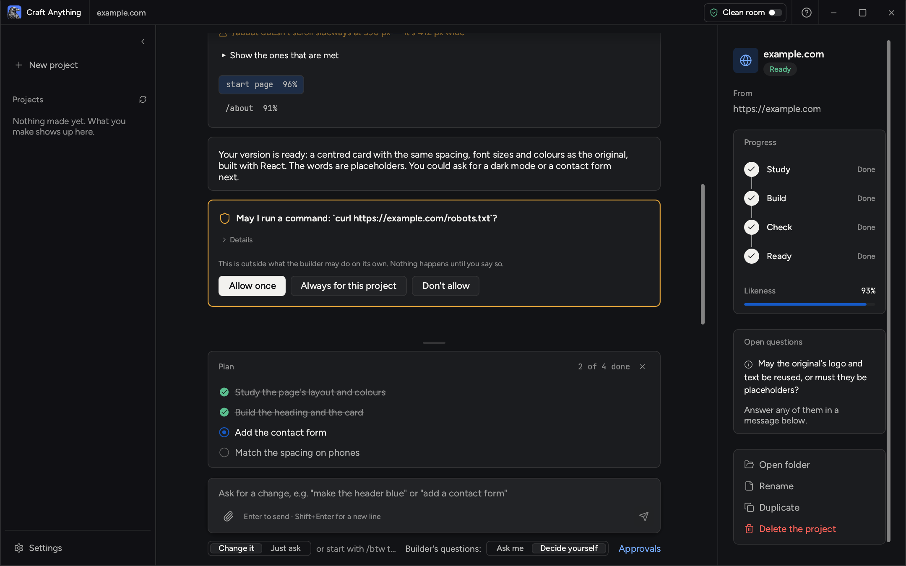

<p align="center">
  <a href="https://getartcraft.com/">
    <picture>
      <source media="(prefers-color-scheme: dark)" srcset="docs/brand/artcraft-logo-white.svg">
      
    </picture>
  </a>
</p>

<p align="center">
  
</p>

<h1 align="center">Craft Anything</h1>

<p align="center">
  <a href="README.md">English</a> · <a href="README.ja.md">日本語</a> · <a href="README.zh.md">简体中文</a> · <a href="README.zh-hant.md">繁體中文</a> · <a href="README.ko.md">한국어</a> · <b>Español</b> · <a href="README.fr.md">Français</a> · <a href="README.vi.md">Tiếng Việt</a> · <a href="README.pt.md">Português</a> · <a href="README.th.md">ไทย</a> · <a href="README.tr.md">Türkçe</a>
</p>

<p align="center">
  <b>Mira cómo funciona cualquier sitio web, aplicación o juego, y deja que la IA construya tu propia versión; un motor open source de clean room, en Rust puro.</b><br>
  Apúntalo a un objetivo, di qué quieres, y Craft Anything estudia el original con herramientas de inspección reales,<br>
  hace que un agente de programación construya un proyecto nuevo, compara el resultado con el original y lo refina.
</p>

<p align="center">
  
  
  
  
</p>

<p align="center">
  <a href="https://discord.gg/artcraft"></a>
</p>

<p align="center">
  <a href="#downloads"><b>Descargar Craft Anything</b></a> ·
  <a href="https://getartcraft.com/">ArtCraft</a> ·
  <a href="https://getartcraft.com/apps">Todas las Crafting Apps</a>
</p>

<br>

<p align="center">
  
  <br>
  <sub>Un proyecto de sitio web: cada verificación dice qué tan parecido es lo construido, tú apruebas todo lo que salga de las reglas, y el plan muestra lo que falta.</sub>
</p>

> [!NOTE]
> **ArtCraft es una comunidad de artistas de todo tipo.** Pintores, fotógrafos, cineastas,
> ilustradores, diseñadores, animadores, aficionados y gente que tomó un lápiz la semana pasada.
> Si haces cosas, eres de los nuestros. **[Ven a saludar en Discord](https://discord.gg/artcraft).**

<p align="center">
  <a href="#how-it-works">Cómo funciona</a> ·
  <a href="#two-ways-to-use-it">Dos formas de usarlo</a> ·
  <a href="#ai">IA</a> ·
  <a href="#built-for-agents">Agentes</a> ·
  <a href="#under-the-hood">Por dentro</a> ·
  <a href="#get-started">Empezar</a> ·
  <a href="#status">Estado</a> ·
  <a href="#downloads">Descargas</a> ·
  <a href="https://discord.gg/artcraft">Discord</a>
</p>

<br>

<table>
  <tr>
    <td width="25%" valign="top">
      <h3>🔍 Estudia cualquier cosa</h3>
      Sitios web, aplicaciones de escritorio, apps de teléfono, juegos y archivos: herramientas de inspección reales averiguan cómo están hechos y qué hacen, con la evidencia detrás de cada respuesta.
    </td>
    <td width="25%" valign="top">
      <h3>🛠️ Construye la tuya</h3>
      Di qué quieres ("Recrea este sitio web", "Recrea la jugabilidad de este juego en Rust") y un agente de programación construye un proyecto nuevo en el stack que pidas.
    </td>
    <td width="25%" valign="top">
      <h3>✅ Verificado, no adivinado</h3>
      Cada construcción se compara con el original (páginas en tres anchos de pantalla, la autoprueba del propio juego, las ejecuciones de una app) y se refina hasta que queda cerca.
    </td>
    <td width="25%" valign="top">
      <h3>🤖 Listo para agentes</h3>
      320 herramientas, cada una un comando de CLI y una herramienta MCP, para que cualquier agente maneje el mismo motor que usa la app. Para inspeccionar no hace falta IA.
    </td>
  </tr>
</table>

<br>

<a id="how-it-works"></a>

## Cómo funciona

Apunta Craft Anything a un objetivo, di qué quieres y presiona Start. Trabaja en cuatro pasos y te
pregunta en palabras claras cuando la decisión es tuya:

1. **Estudiar (Study):** inspecciona el original: sus páginas en cada ancho, su código, sus archivos, cómo se ejecuta.
2. **Construir (Build):** un agente de programación construye un proyecto nuevo, en el lenguaje,
   framework o motor que nombre tu petición (o uno sensato por defecto).
3. **Verificar (Check):** compara lo construido con el original y enumera lo que aún no coincide.
4. **Listo (Ready):** abre, juega o previsualiza el resultado, o pide cambios y lo refina.

<table>
  <tr>
    <td width="50%" valign="top">
      <br>
      <sub><b>Make:</b> elige qué recrear, di qué quieres y presiona Start.</sub>
    </td>
    <td width="50%" valign="top">
      <br>
      <sub><b>Ready:</b> juega, o pide cambios abajo.</sub>
    </td>
  </tr>
</table>

<a id="two-ways-to-use-it"></a>

## Dos formas de usarlo

- **Simple** (por defecto): "What do you want to make?". Elige un sitio web, una app o un juego,
  descríbelo y presiona Start. La página del proyecto muestra los cuatro pasos (Study → Build → Check → Ready),
  lo que el agente está haciendo en palabras claras, tarjetas de preguntas y aprobaciones, qué tan
  parecido es el resultado y botones para abrir el resultado o su carpeta. Pide cambios en la caja
  de abajo. "Just look inside" abre un objetivo para hacer preguntas sin construir nada (en modo Deep).
- **Advanced**: el banco de trabajo completo: todas las herramientas (Ctrl/Cmd+K), funciones, cadenas,
  pseudo-C, desensamblado, hexadecimal, gráficos de llamadas, evidencia, incógnitas, trabajos, registros
  y la consola del agente.

Ambos modos manejan el mismo motor.

<a id="clean-room-or-deep"></a>

## Clean room o Deep

- **Clean room** (por defecto): no se lee nada de dentro del original, ni su código, ni sus archivos,
  ni el código fuente de la página. Craft Anything trabaja con lo que puedes ver: imágenes que añades,
  el sitio web tal como lo ve un visitante (capturas, texto visible, maquetación medida, colores,
  tipografías y espaciado, menús abiertos) y, cuando lo permites, una imagen de la ventana de la app.
  Las herramientas que mirarían dentro se rechazan y dicen cómo activar el modo Deep.
- **Deep**: se usan todas las herramientas, para tu uso privado. El código y los archivos de un
  programa se leen con los motores integrados (y con Ghidra si está instalado), el JavaScript de un
  sitio web se lee y su página de inicio se observa, y el constructor puede usarlos todos.

Clean room es una regla sobre lo que Craft Anything ofrece y rechaza. No es una caja de arena del
sistema operativo: no aísla tu computadora. Un agente de programación que ejecutes sigue actuando
como tú, y lo que puede leer, escribir o ejecutar depende de sus propios permisos. Cuáles de las
herramientas propias de un agente puede rechazar Craft Anything cambia según el agente; para las
herramientas de Claude Code en chats y preguntas, ver
[`docs/claude-code.md`](docs/claude-code.md).

Cámbialo en la barra de título o en Settings, con `settings_set deep_mode true`, o para una sola
ejecución de CLI con `--deep` (o `--clean-room`).

<p align="center">
  
  <br>
  <sub><b>Advanced:</b> funciones, pseudo-C, el agente y la evidencia detrás de cada respuesta.</sub>
</p>

<a id="ai"></a>

## IA

Construir necesita un agente de programación en tu computadora. **Claude Code** es el primero con
soporte: Craft Anything ejecuta tu propio programa `claude`, sin modificar, que usa tu propio inicio
de sesión; Craft Anything nunca ve ni maneja tu cuenta. Tu uso se rige por tu propio acuerdo con
Anthropic. Ver [docs/claude-code.md](docs/claude-code.md) para el cómo y el porqué. Existe un
adaptador para Codex, pero todavía no se ha verificado en una instalación real. **GitHub Copilot**
puede usar tu CLI de Copilot instalada a través de ACP: inicia sesión aparte con `copilot login`.
Otros agentes que hablan ACP (Gemini CLI, Qwen Code, opencode, goose, Hermes, Maki) se pueden cambiar
a él por backend; de ellos, solo Maki se ha ejecutado en vivo. Anthropic, OpenAI, OpenRouter y
servidores locales compatibles con OpenAI están disponibles para preguntas y análisis (Settings → AI).

<a id="built-for-agents"></a>

## Hecho para agentes

Cada herramienta es también un subcomando de CLI y una herramienta MCP, así que un agente puede
estudiar un objetivo o ejecutar una reconstrucción completa sin la app:

```sh
craft-anything-cli commands                                   # every tool, by toolset
craft-anything-cli mcp                                        # serve them to any MCP client
craft-anything-cli rebuild https://example.com "Recreate this website"
```

Los resultados son registros de evidencia con su confianza, cobertura y limitaciones; los grandes
vuelven primero como resumen y se paginan con `core_evidence_browse`. `craft-anything-cli setup`
conecta Craft Anything con las apps de agentes de programación.

<a id="under-the-hood"></a>

## Por dentro

Un motor de ingeniería inversa en Rust puro con 320 herramientas (300 en el motor, el resto de las
capas de IA y de setup) para programas nativos, .NET, Java, Android, Apple, Electron/JavaScript,
sitios web, firmware, capturas de paquetes, bases de datos y archivos de juegos. Sus propios
decodificadores, desensamblador y descompilador funcionan sin ningún programa externo; el modo Deep
los usa todos, y Ghidra cuando está instalado. Impulsa la app de escritorio (egui), la CLI y el
servidor MCP, y parte de él corre en el navegador como WebAssembly. La lista completa está en
[docs/tools.md](docs/tools.md).

<a id="get-started"></a>

## Empezar

Requiere Rust **1.97 o posterior** (una dependencia lo necesita; `rustup update`). En Debian o Ubuntu,
la app de escritorio también necesita:

```sh
sudo apt-get install build-essential libxkbcommon-dev libxkbcommon-x11-0 libwayland-dev libx11-dev libxrandr-dev libxi-dev libgl1-mesa-dev libgtk-3-dev
```

Después:

```sh
git clone https://github.com/storytold/craft-anything && cd craft-anything
cargo run --release -p craft-anything                # the desktop app
cargo install --path apps/craft-anything-cli         # the CLI, as `craft-anything-cli`
craft-anything-cli doctor                            # checks the install, coding agents and engines
```

Construir necesita un agente de programación con sesión iniciada en tu computadora (ver [IA](#ai));
`doctor` dice qué falta. Reconstruye desde la línea de comandos (las preguntas se hacen en la terminal):

```sh
craft-anything-cli rebuild https://example.com "Recreate this website"
craft-anything-cli rebuild - "A snake game in Rust" --rounds 1
craft-anything-cli rebuild https://example.com "Make the header blue" --continue-in "<project folder>"
craft-anything-cli rebuild - "Add a contact form" --project-folder "<your folder>" --existing edit
```

Los proyectos nuevos van en `Documents/Craft Anything` (cámbialo en Settings → General). Cada carpeta
de proyecto guarda `craft.json` (la petición, el objetivo, el estado y el historial), `capture/` (lo
grabado del objetivo), `app/` (el proyecto generado), `checks/` (cada comparación contra el original),
`investigation.cany/` (evidencia) e `inbox/` (preguntas abiertas).

Un proyecto también puede empezar en una carpeta que elijas (Choose a folder… en Start, o
`--project-folder`). Si ya tiene archivos, dices qué son: la app misma, que el constructor edita en el
lugar, o material del que partir, con la app construida en `app/` junto a ellos (Settings → General
puede recordar la respuesta). Settings → General también lista proyectos de más carpetas; quitar uno
solo lo saca de la lista.

<a id="status"></a>

## Estado

> [!IMPORTANT]
> **Estado:** Craft Anything está en alfa temprana. Lo que ya funciona, lo que está parcial y lo que viene:
>
> - **Funciona hoy:** la app de escritorio (Simple y Advanced), la CLI y el servidor MCP; el flujo
>   Study → Build → Check → Refine para sitios web, apps y juegos con Claude Code como constructor;
>   verificaciones de sitios web en tres anchos de pantalla; reconstrucciones de juegos en Unity, Unreal
>   o Godot; modo Deep con Ghidra; imágenes y modelos 3D generados (opcional, con tu propia clave de
>   fal.ai); plugins (servidores MCP, y componentes WASM en construcciones con la opción `wasm-plugins`).
> - **Parcial:** construir con claves de API y otros agentes de programación (hecho, aún no ejecutado en
>   vivo), verificaciones de comportamiento para apps y juegos, algunas herramientas de motor probadas
>   solo contra sustitutos.
> - **Publicado:** hay releases públicos con instaladores para Windows, macOS, Linux y FreeBSD en la
>   [página de Releases](https://github.com/storytold/craft-anything/releases); siguen siendo alfa.
> - **Siguiente:** el plan gestionado.
>
> [docs/STATUS.md](docs/STATUS.md) tiene el detalle y cómo se comprobó cada parte,
> [docs/tool-status.md](docs/tool-status.md) la lista herramienta por herramienta, y
> [docs/ROADMAP.md](docs/ROADMAP.md) el plan, punto por punto. Abre issues, o cuéntanos qué se rompió
> en [Discord](https://discord.gg/artcraft).

**Uso responsable.** Usa Craft Anything en software que sea tuyo o que tengas permiso de examinar.
Nunca evade DRM, inicios de sesión ni anti-cheat. Las reconstrucciones recrean maquetación, estilo y
comportamiento a partir de evidencia; al agente se le indica que no copie logotipos, fotos ni texto
salvo que confirmes que son tuyos o que tienes permiso.

**Instalar dependencias ejecuta código.** Cuando un constructor instala las dependencias de un
proyecto, los comandos se ejecutan en tu computadora, y los paquetes pueden ejecutar código mientras
se instalan. npm ejecuta los scripts de instalación de cada paquete por defecto, y los scripts de
compilación de Rust y los paquetes de código fuente de Python ejecutan su propio código de setup.
Craft Anything pregunta antes de un comando de un tipo que no ha visto en este proyecto (`npm`,
`cargo`…). Elegir "always allow" para `npm` deja que todos los comandos npm posteriores se ejecuten
sin preguntar, así que hazlo solo en un proyecto cuyas dependencias sean de confianza. Para instalar paquetes
npm sin sus scripts de instalación, usa `npm install --ignore-scripts`.

<a id="downloads"></a>

## Descargas

En GitHub, el [último release](https://github.com/storytold/craft-anything/releases/latest) tiene todas las compilaciones listadas abajo, y [todos los releases](https://github.com/storytold/craft-anything/releases) tienen las versiones anteriores y sus notas. `<ver>` en los nombres de archivo es el número de versión, y `SHA256SUMS.txt` lista una suma de verificación por archivo.

### Windows

| Compilación | Instalador | Portable |
|---|---|---|
| x64 (Intel/AMD de 64 bits) | `craft-anything-<ver>-windows-x64.msi` | `craft-anything-<ver>-windows-x64-portable.zip` |
| arm64 (Snapdragon y otras PC ARM) | `craft-anything-<ver>-windows-arm64.msi` | `craft-anything-<ver>-windows-arm64-portable.zip` |
| x86 (32 bits) | `craft-anything-<ver>-windows-x86.msi` | `craft-anything-<ver>-windows-x86-portable.zip` |

Los instaladores y ejecutables están firmados. El zip portable guarda sus ajustes junto a la app.

### macOS

| Compilación | Archivo | Notas |
|---|---|---|
| App, universal (Apple silicon + Intel) | `craft-anything-<ver>-macos-universal.dmg` | Firmada y notarizada |
| Herramienta de línea de comandos, universal | `craft-anything-cli-<ver>-macos-universal.zip` | Firmada y notarizada; ver abajo si macOS la bloquea |

Las versiones posteriores a la 0.2.0 incluyen la herramienta de línea de comandos en la app, así que
las compilaciones no necesitan el zip aparte. Solo lo necesitas para usar la línea de comandos sin la app.

Una descarga del zip desde el navegador puede detenerse con "Apple could not verify
craft-anything-cli" (un programa suelto no puede llevar su notarización consigo, así que macOS tiene
que consultarla en línea). Una descarga desde la terminal no se comprueba así, de modo que usa esto
en su lugar:

```sh
ver=0.2.0   # change this to the version you want
curl -fLO "https://github.com/storytold/craft-anything/releases/download/v$ver/craft-anything-cli-$ver-macos-universal.zip"
ditto -x -k "craft-anything-cli-$ver-macos-universal.zip" .
mkdir -p ~/.local/bin
mv "craft-anything-cli-$ver-macos-universal/craft-anything-cli" ~/.local/bin/
~/.local/bin/craft-anything-cli --version
```

Para ejecutarla solo como `craft-anything-cli`, añade `~/.local/bin` a tu `PATH`.

Si ya tienes la copia bloqueada, presiona Done (no Move to Bin) y luego ejecuta
`xattr -d com.apple.quarantine <ruta a craft-anything-cli>`, o permítela en System Settings →
Privacy & Security → Open Anyway.

#### Comprobar que una descarga de Mac está firmada y notarizada

Cada release de Mac se firma con un certificado Developer ID y Apple lo notariza. Para comprobar una
descarga tú mismo, ejecuta esto en Terminal (cambia `<ver>` por la versión y las rutas por las tuyas):

```sh
# The disk image: "accepted" and "source=Notarized Developer ID" mean it passed
spctl --assess --type open --context context:primary-signature -v "craft-anything-<ver>-macos-universal.dmg"
# The notarization ticket is attached: prints "The validate action worked!"
xcrun stapler validate "craft-anything-<ver>-macos-universal.dmg"

# The app, after you open the disk image: the signature must verify
codesign --verify --deep --strict --verbose=2 "/Volumes/<disk image name>/Craft Anything.app"
spctl --assess --type execute --verbose "/Volumes/<disk image name>/Craft Anything.app"

# The command-line tool: a bare program can't carry a ticket, so macOS checks it online
codesign --verify --strict --verbose=2 ~/.local/bin/craft-anything-cli
codesign -dv --verbose=4 ~/.local/bin/craft-anything-cli 2>&1 | grep Authority
```

Las líneas `Authority` deben nombrar un certificado "Developer ID Application". Si una comprobación
falla, no ejecutes el archivo; repórtalo con la salida y la etiqueta del release.

### Linux

| Formato | x86_64 | aarch64 (ARM64) | Notas |
|---|---|---|---|
| AppImage | `craft-anything-<ver>-linux-x86_64.AppImage` | `craft-anything-<ver>-linux-aarch64.AppImage` | Corre en cualquier parte; se actualiza sola con [AppImageUpdate](https://github.com/AppImageCommunity/AppImageUpdate) (archivos `.zsync`) |
| Flatpak | `craft-anything-<ver>-linux-x86_64.flatpak` | `craft-anything-<ver>-linux-aarch64.flatpak` | En caja de arena; `flatpak install --user <file>` |
| Debian/Ubuntu | `craft-anything-<ver>-linux-x86_64.deb` | `craft-anything-<ver>-linux-aarch64.deb` | |
| Fedora/RHEL/openSUSE | `craft-anything-<ver>-linux-x86_64.rpm` | `craft-anything-<ver>-linux-aarch64.rpm` | |
| Tarball | `craft-anything-<ver>-linux-x86_64.tar.gz` | `craft-anything-<ver>-linux-aarch64.tar.gz` | Descomprime donde quieras |

RISC-V (riscv64): `craft-anything-<ver>-linux-riscv64.tar.gz`, solo tarball.

El AppImage también lleva la CLI: ejecuta `<AppImage> --cli <comando>` (por ejemplo
`<AppImage> --cli mcp` para un cliente MCP), o haz un enlace al AppImage llamado
`craft-anything-cli` y ejecútalo.

### FreeBSD

| Compilación | Archivo |
|---|---|
| x86_64 | `craft-anything-<ver>-freebsd-x86_64.tar.gz` |

### Web (WebAssembly)

| Compilación | Archivo | Notas |
|---|---|---|
| Visor de navegador | `craft-anything-web-<ver>.zip` | Dice qué es un archivo, en el navegador (el archivo nunca sale de él); aloja la carpeta en cualquier servidor web estático ([packaging/web/README.md](packaging/web/README.md)) |

<br>

<p align="center">
  <a href="https://discord.gg/artcraft"></a>
</p>

<h3 align="center">Ven a hacer cosas con nosotros</h3>

<p align="center">
  Nuestro Discord es donde se junta gente que hace de todo: quien pinta, quien fotografía, quien
  dibuja, quien corta cine, quien compone tipografía, y quien todavía anda averiguando qué le gusta
  hacer. Comparte en qué estás trabajando, pide ayuda, cuéntanos qué está roto o qué te gustaría que
  estas herramientas pudieran hacer. Sea cual sea tu medio y sin importar cuánto lleves en esto,
  aquí eres bienvenido.
</p>

<p align="center">
  <a href="https://discord.gg/artcraft"><b>discord.gg/artcraft</b></a> ·
  <a href="https://getartcraft.com/">getartcraft.com</a> ·
  <a href="https://getartcraft.com/apps">Las Crafting Apps</a> ·
  <a href="https://github.com/storytold/craft-anything">Craft Anything</a>
</p>

---

## La suite de Craft Apps

| | App | Para qué sirve | Código | Más información |
|:-:|---|---|---|---|
|  | **PhotoCraft** | Edición de imagen: capas, máscaras, texto y archivos PSD reales | [GitHub](https://github.com/storytold/photocraft) | [Sitio web](https://getartcraft.com/apps/photocraft) |
|  | **VectorCraft** | Ilustración vectorial | [GitHub](https://github.com/storytold/vectorcraft) | [Sitio web](https://getartcraft.com/apps/vectorcraft) |
|  | **FilmCraft** | Edición de video, color y sonido | [GitHub](https://github.com/storytold/filmcraft) | [Sitio web](https://getartcraft.com/apps/filmcraft) |
|  | **LightCraft** | Biblioteca de fotos y revelado de RAW | [GitHub](https://github.com/storytold/lightcraft) | [Sitio web](https://getartcraft.com/apps/lightcraft) |
|  | **PdfCraft** | Leer, organizar y proteger PDF | [GitHub](https://github.com/storytold/pdfcraft) | [Sitio web](https://getartcraft.com/apps/pdfcraft) |
|  | **EffectCraft** | Motion graphics y efectos visuales | [GitHub](https://github.com/storytold/effectcraft) | [Sitio web](https://getartcraft.com/apps/effectcraft) |
|  | **DesignCraft** | Maquetación de páginas y publicación | [GitHub](https://github.com/storytold/designcraft) | [Sitio web](https://getartcraft.com/apps/designcraft) |
|  | **FigCraft** | Diseño de interfaces y prototipado | [GitHub](https://github.com/storytold/figcraft) | [Sitio web](https://getartcraft.com/apps/figcraft) |
|  | **WordCraft** | Procesamiento de textos y documentos | [GitHub](https://github.com/storytold/wordcraft) | [Sitio web](https://getartcraft.com/apps/wordcraft) |
|  | **SoundCraft** | Grabación y edición de audio | [GitHub](https://github.com/storytold/soundcraft) | [Sitio web](https://getartcraft.com/apps/soundcraft) |
|  | **DeckCraft** | Presentaciones y diapositivas | [GitHub](https://github.com/storytold/deckcraft) | [Sitio web](https://getartcraft.com/apps/deckcraft) |
|  | **CADCraft** | Diseño asistido por computadora | [GitHub](https://github.com/storytold/cadcraft) | [Sitio web](https://getartcraft.com/apps/cadcraft) |
|  | **GridCraft** | Hojas de cálculo y datos | [GitHub](https://github.com/storytold/gridcraft) | [Sitio web](https://getartcraft.com/apps/gridcraft) |
|  | **TextureCraft** | Pintura de texturas 3D | [GitHub](https://github.com/storytold/texturecraft) | [Sitio web](https://getartcraft.com/apps/texturecraft) |
|  | **MaterialCraft** | Materiales procedurales por nodos | [GitHub](https://github.com/storytold/materialcraft) | [Sitio web](https://getartcraft.com/apps/materialcraft) |
|  | **Craft Anything** | Ver cómo funciona cualquier software y construir el tuyo | [GitHub](https://github.com/storytold/craft-anything) | [Sitio web](https://getartcraft.com/apps/craft-anything) |
|  | **SolidCraft** | CAD 3D paramétrico de Tangency Labs (app de la comunidad) | [GitHub](https://github.com/tangency-labs/solidcraft) | |

<a id="license-and-credits"></a>

## Licencia y créditos

Craft Anything tiene licencia dual [MIT](LICENSE-MIT) o [Apache-2.0](LICENSE-APACHE), a tu elección.
Copyright (c) 2026 ArtCraft Team and the Craft Anything contributors. Los avisos requeridos están en [NOTICE](NOTICE).

Las tipografías, iconos, imágenes y otros recursos incluidos conservan sus propias licencias abiertas;
cada uno aparece con su autor, origen y licencia en [ATTRIBUTION.md](ATTRIBUTION.md).

Las capturas muestran proyectos de ejemplo hechos para ellas: example.com, un juego de serpiente y un
pequeño programa de calculadora.

El nombre ArtCraft, la marca denominativa y los logotipos en [`docs/brand/`](docs/brand/) son marcas
del ArtCraft Team y no están cubiertos por esta licencia. Solo pueden usarse sin modificar y solo como
parte de este repositorio y de Craft Anything, bajo [`docs/brand/LICENSE-brand.txt`](docs/brand/LICENSE-brand.txt).
Los forks y las versiones modificadas deben eliminarlos.

<p align="center">
  <a href="https://getartcraft.com/"></a><br>
  <sub>Hecho por el equipo y la comunidad de <a href="https://getartcraft.com/">ArtCraft</a>.</sub>
</p>

---

<sub>Esta página es una traducción al español de [README.md](README.md). Si hay discrepancias, prevalece la versión en inglés.</sub>
