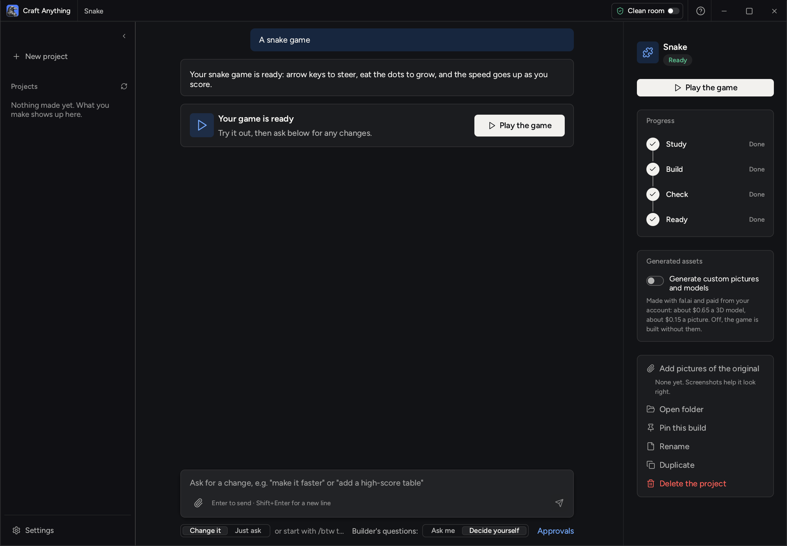

<!-- Tệp này là bản dịch tiếng Việt của README.md; khi bản tiếng Anh thay đổi, hãy cập nhật cả tệp này. -->

<p align="center">
  <a href="https://getartcraft.com/">
    <picture>
      <source media="(prefers-color-scheme: dark)" srcset="docs/brand/artcraft-logo-white.svg">
      
    </picture>
  </a>
</p>

<p align="center">
  
</p>

<h1 align="center">Craft Anything</h1>

<p align="center">
  <a href="README.md">English</a> · <a href="README.ja.md">日本語</a> · <a href="README.zh.md">简体中文</a> · <a href="README.zh-hant.md">繁體中文</a> · <a href="README.ko.md">한국어</a> · <a href="README.es.md">Español</a> · <a href="README.fr.md">Français</a> · <b>Tiếng Việt</b> · <a href="README.pt.md">Português</a> · <a href="README.th.md">ไทย</a> · <a href="README.tr.md">Türkçe</a>
</p>

<p align="center">
  <b>Xem bất kỳ website, ứng dụng hay trò chơi nào hoạt động ra sao, rồi để AI dựng phiên bản của riêng bạn; một engine mã nguồn mở, phòng sạch, viết bằng Rust thuần.</b><br>
  Chỉ vào một mục tiêu, nói điều bạn muốn, và nó sẽ nghiên cứu bản gốc bằng các công cụ kiểm tra thật,<br>
  để một coding agent dựng một dự án mới, đối chiếu kết quả với bản gốc rồi tinh chỉnh cho khớp.
</p>

<p align="center">
  
  
  
  
</p>

<p align="center">
  <a href="https://discord.gg/artcraft"></a>
</p>

<p align="center">
  <a href="#tai-xuong"><b>Tải Craft Anything</b></a> ·
  <a href="https://getartcraft.com/">ArtCraft</a> ·
  <a href="https://getartcraft.com/apps">Tất cả ứng dụng Crafting</a>
</p>

<br>

<p align="center">
  
  <br>
  <sub>Một dự án website: mỗi kiểm tra cho biết mức độ giống nhau của bản dựng, bạn phê duyệt mọi thứ ngoài quy tắc, và kế hoạch hiển thị những gì còn lại.</sub>
</p>

> [!NOTE]
> **ArtCraft là cộng đồng nghệ sĩ thuộc mọi lĩnh vực.** Họa sĩ, nhiếp ảnh gia,
> nhà làm phim, họa sĩ minh họa, nhà thiết kế, họa sĩ hoạt hình, người yêu thích,
> và cả những người mới cầm bút tuần trước. Nếu bạn làm ra thứ gì đó, bạn là một trong số chúng tôi. **[Hãy ghé chào chúng tôi trên Discord](https://discord.gg/artcraft).**

<p align="center">
  <a href="#cach-hoat-dong">Cách hoạt động</a> ·
  <a href="#hai-cach-su-dung">Hai cách sử dụng</a> ·
  <a href="#ai">AI</a> ·
  <a href="#danh-cho-agent">Dành cho agent</a> ·
  <a href="#ben-trong">Bên trong</a> ·
  <a href="#bat-dau">Bắt đầu</a> ·
  <a href="#trang-thai">Trạng thái</a> ·
  <a href="#tai-xuong">Tải xuống</a> ·
  <a href="https://discord.gg/artcraft">Discord</a>
</p>

<br>

<table>
  <tr>
    <td width="25%" valign="top">
      <h3>🔍 Nghiên cứu bất cứ thứ gì</h3>
      Website, ứng dụng desktop, ứng dụng điện thoại, trò chơi và tệp tin: các công cụ kiểm tra thật sẽ tìm hiểu chúng được dựng ra sao và làm được gì, kèm bằng chứng đằng sau mỗi câu trả lời.
    </td>
    <td width="25%" valign="top">
      <h3>🛠️ Tự dựng của riêng bạn</h3>
      Nói điều bạn muốn ("Tái tạo website này", "Tái tạo lối chơi của trò chơi này bằng Rust") và một coding agent sẽ dựng một dự án mới bằng stack bạn yêu cầu.
    </td>
    <td width="25%" valign="top">
      <h3>✅ Đã kiểm tra, không đoán mò</h3>
      Mỗi bản dựng đều được đối chiếu với bản gốc (các trang ở ba độ rộng màn hình, bài tự kiểm tra của chính trò chơi, các lần chạy của ứng dụng) và tinh chỉnh đến khi gần giống bản gốc.
    </td>
    <td width="25%" valign="top">
      <h3>🤖 Sẵn sàng cho agent</h3>
      320 công cụ, mỗi công cụ vừa là một lệnh CLI vừa là một MCP tool, để bất kỳ agent nào cũng điều khiển được cùng engine mà ứng dụng dùng. Không cần AI để kiểm tra.
    </td>
  </tr>
</table>

<br>

## <a id="cach-hoat-dong"></a>Cách hoạt động

Chỉ Craft Anything vào một mục tiêu, nói điều bạn muốn, rồi nhấn Start. Nó làm việc theo bốn bước,
hỏi bạn bằng lời lẽ đơn giản khi quyết định thuộc về bạn:

1. **Tìm hiểu:** kiểm tra bản gốc: các trang của nó ở mọi độ rộng, mã nguồn, tệp tin, cách nó chạy.
2. **Xây dựng:** một coding agent dựng một dự án mới, bằng ngôn ngữ, framework hoặc engine mà
   yêu cầu của bạn nêu tên (hoặc một lựa chọn mặc định hợp lý).
3. **Kiểm tra:** đối chiếu bản dựng với bản gốc và liệt kê những điểm chưa khớp.
4. **Sẵn sàng:** mở, chơi hoặc xem trước kết quả, hoặc yêu cầu thay đổi và nó sẽ tinh chỉnh.

<table>
  <tr>
    <td width="50%" valign="top">
      <br>
      <sub><b>Tạo:</b> chọn thứ muốn tái tạo, nói điều bạn muốn, nhấn Start.</sub>
    </td>
    <td width="50%" valign="top">
      <br>
      <sub><b>Sẵn sàng:</b> chơi trò chơi, hoặc yêu cầu thay đổi bên dưới.</sub>
    </td>
  </tr>
</table>

## <a id="hai-cach-su-dung"></a>Hai cách sử dụng

- **Đơn giản** (mặc định): "Bạn muốn tạo gì?" Chọn một website, ứng dụng hay trò chơi, mô tả nó,
  nhấn Start. Một trang dự án hiển thị bốn bước (Tìm hiểu → Xây dựng → Kiểm tra → Sẵn sàng), agent đang làm
  gì bằng lời lẽ đơn giản, thẻ câu hỏi và thẻ phê duyệt, mức độ giống nhau của kết quả, và
  các nút để mở kết quả hoặc thư mục của nó. Yêu cầu thay đổi trong ô nhập ở cuối trang.
  "Chỉ xem bên trong" mở một mục tiêu để đặt câu hỏi mà không dựng gì cả (trong chế độ Chuyên sâu).
- **Nâng cao**: bàn làm việc đầy đủ: mọi công cụ (Ctrl/Cmd+K), hàm, chuỗi, mã giả C,
  mã hợp ngữ, mã hex, đồ thị lời gọi, bằng chứng, điểm chưa rõ, tiến trình, nhật ký và console của agent.

Cả hai chế độ đều dùng cùng một engine.

## <a id="phong-sach-hay-chuyen-sau"></a>Phòng sạch hay Chuyên sâu

- **Phòng sạch (Clean room)** (mặc định): không đọc bất cứ thứ gì bên trong bản gốc, không phải mã nguồn, tệp tin hay mã nguồn
  trang. Craft Anything làm việc từ những gì bạn nhìn thấy: hình ảnh bạn thêm vào, website dưới góc nhìn của khách truy cập
  (ảnh chụp màn hình, văn bản hiển thị, bố cục đo được, màu sắc, phông chữ và khoảng cách, menu đã mở)
  và, khi bạn cho phép, ảnh chụp cửa sổ ứng dụng. Các công cụ muốn nhìn vào bên trong sẽ bị từ chối
  và hướng dẫn cách bật chế độ Chuyên sâu.
- **Chuyên sâu (Deep)**: dùng mọi công cụ, cho mục đích sử dụng riêng của bạn. Mã nguồn và tệp tin của chương trình được đọc bằng các
  engine tích hợp (và Ghidra khi đã cài đặt), JavaScript của website được đọc và trang bắt đầu
  của nó được theo dõi, và trình dựng có thể dùng tất cả.

Phòng sạch là quy tắc về những gì Craft Anything cung cấp và từ chối. Nó không phải là sandbox của hệ điều hành:
nó không cô lập máy tính của bạn. Một coding agent bạn chạy vẫn hành động với tư cách là bạn, và những gì nó có thể
đọc, ghi hay chạy tùy thuộc vào quyền của chính nó. Mỗi công cụ riêng của agent mà Craft Anything có thể
từ chối thì khác nhau theo từng agent; với các công cụ của Claude Code trong trò chuyện và câu hỏi, xem
[`docs/claude-code.md`](docs/claude-code.md).

Chuyển đổi trên thanh tiêu đề hoặc trong Cài đặt, bằng `settings_set deep_mode true`, hoặc cho một lần chạy CLI bằng
`--deep` (hoặc `--clean-room`).

<p align="center">
  
  <br>
  <sub><b>Nâng cao:</b> hàm, mã giả C, agent và bằng chứng đằng sau mỗi câu trả lời.</sub>
</p>

## <a id="ai"></a>AI

Việc dựng cần một coding agent trên máy tính của bạn. **Claude Code** được hỗ trợ trước tiên: Craft
Anything chạy chương trình `claude` gốc, không chỉnh sửa của bạn, dùng tài khoản đăng nhập của chính bạn; Craft Anything
không bao giờ thấy hay xử lý tài khoản của bạn. Việc bạn dùng nó thuộc thỏa thuận của riêng bạn với
Anthropic. Xem [docs/claude-code.md](docs/claude-code.md) để biết cách làm và lý do. Đã có adapter cho Codex
nhưng chưa được kiểm chứng trên bản cài đặt thật. **GitHub Copilot** có thể dùng Copilot CLI đã cài đặt
của bạn qua ACP: đăng nhập riêng bằng `copilot login`. Các agent khác nói được ACP (Gemini CLI,
Qwen Code, opencode, goose, Hermes, Maki) có thể chuyển sang dùng nó theo từng backend; trong số đó, chỉ Maki đã
được chạy trực tiếp. Anthropic, OpenAI, OpenRouter và các máy chủ tương thích OpenAI cục bộ
đều dùng được cho câu hỏi và phân tích (Cài đặt → AI).

## <a id="danh-cho-agent"></a>Dành cho agent

Mỗi công cụ cũng là một lệnh con của CLI và một MCP tool, để agent có thể nghiên cứu một mục tiêu hay chạy
toàn bộ quá trình tái dựng mà không cần ứng dụng:

```sh
craft-anything-cli commands                                   # every tool, by toolset
craft-anything-cli mcp                                        # serve them to any MCP client
craft-anything-cli rebuild https://example.com "Recreate this website"
```

Kết quả là các bản ghi bằng chứng kèm độ tin cậy, độ bao phủ và giới hạn của chúng; kết quả lớn trả về
bản tóm tắt trước rồi phân trang bằng `core_evidence_browse`. `craft-anything-cli setup`
kết nối Craft Anything với các ứng dụng coding-agent.

## <a id="ben-trong"></a>Bên trong

Một engine dịch ngược bằng Rust thuần với 320 công cụ (300 trong engine, còn lại từ lớp AI và
thiết lập) cho chương trình native, .NET, Java, Android, Apple, Electron/JavaScript, website,
firmware, bản ghi gói tin, cơ sở dữ liệu và tệp trò chơi. Các bộ giải mã, trình hợp ngữ và
trình dịch ngược của riêng nó hoạt động mà không cần chương trình bên ngoài nào; chế độ Chuyên sâu dùng tất cả,
cùng Ghidra khi đã cài đặt. Nó vận hành ứng dụng desktop (egui), CLI và máy chủ MCP, và một phần chạy trong
trình duyệt dưới dạng WebAssembly. Danh sách đầy đủ có trong [docs/tools.md](docs/tools.md).

## <a id="bat-dau"></a>Bắt đầu

Yêu cầu Rust **1.97 trở lên** (một dependency cần nó; `rustup update`). Trên Debian hoặc Ubuntu,
ứng dụng desktop còn cần:

```sh
sudo apt-get install build-essential libxkbcommon-dev libxkbcommon-x11-0 libwayland-dev libx11-dev libxrandr-dev libxi-dev libgl1-mesa-dev libgtk-3-dev
```

Sau đó:

```sh
git clone https://github.com/storytold/craft-anything && cd craft-anything
cargo run --release -p craft-anything                # the desktop app
cargo install --path apps/craft-anything-cli         # the CLI, as `craft-anything-cli`
craft-anything-cli doctor                            # checks the install, coding agents and engines
```

Việc dựng cần một coding agent đã đăng nhập trên máy tính của bạn (xem [AI](#ai)); `doctor` sẽ cho biết
còn thiếu gì. Tái dựng từ dòng lệnh (câu hỏi được hỏi trong terminal):

```sh
craft-anything-cli rebuild https://example.com "Recreate this website"
craft-anything-cli rebuild - "A snake game in Rust" --rounds 1
craft-anything-cli rebuild https://example.com "Make the header blue" --continue-in "<project folder>"
craft-anything-cli rebuild - "Add a contact form" --project-folder "<your folder>" --existing edit
```

Dự án mới nằm trong `Documents/Craft Anything` (đổi trong Cài đặt → Chung). Mỗi thư mục dự án
chứa `craft.json` (yêu cầu, mục tiêu, trạng thái và lịch sử), `capture/` (những gì đã
ghi lại từ mục tiêu), `app/` (dự án đã tạo), `checks/` (mỗi lần đối chiếu với
bản gốc), `investigation.cany/` (bằng chứng) và `inbox/` (câu hỏi đang mở).

Dự án cũng có thể bắt đầu trong một thư mục bạn chọn (Chọn thư mục… dưới Start, hoặc `--project-folder`).
Nếu trong đó đã có tệp, bạn cho biết chúng là gì: chính ứng dụng, mà trình dựng sửa trực tiếp tại chỗ,
hoặc tư liệu để bắt đầu, với ứng dụng được dựng trong `app/` bên cạnh (Cài đặt → Chung có thể
ghi nhớ câu trả lời). Cài đặt → Chung cũng liệt kê dự án từ nhiều thư mục hơn; gỡ một dự án
chỉ xóa nó khỏi danh sách.

## <a id="trang-thai"></a>Trạng thái

> [!IMPORTANT]
> **Trạng thái:** Craft Anything đang ở giai đoạn alpha sớm. Những gì hoạt động hôm nay, những gì mới một phần và tiếp theo là gì:
>
> - **Hoạt động hôm nay:** ứng dụng desktop (Đơn giản và Nâng cao), CLI và máy chủ MCP; quy trình
>   Tìm hiểu → Xây dựng → Kiểm tra → Tinh chỉnh cho website, ứng dụng và trò chơi với Claude Code làm
>   trình dựng; kiểm tra website ở ba độ rộng màn hình; tái dựng trò chơi bằng Unity, Unreal hoặc Godot; chế độ
>   Chuyên sâu với Ghidra; ảnh và mô hình 3D tạo ra (tự nguyện, dùng khóa fal.ai của riêng bạn); plugin (máy chủ
>   MCP, và thành phần WASM trong các bản dựng có tùy chọn `wasm-plugins`).
> - **Mới một phần:** dựng bằng khóa API và các coding agent khác (đã dựng, chưa chạy trực tiếp),
>   kiểm tra hành vi cho ứng dụng và trò chơi, vài công cụ engine mới chỉ kiểm tra với bản thay thế.
> - **Đã phát hành:** bản phát hành công khai với trình cài đặt cho Windows, macOS, Linux và FreeBSD được
>   đăng trên [trang Releases](https://github.com/storytold/craft-anything/releases); chúng vẫn là alpha.
> - **Tiếp theo:** gói managed.
>
> [docs/STATUS.md](docs/STATUS.md) có chi tiết và cách từng phần được kiểm tra,
> [docs/tool-status.md](docs/tool-status.md) có danh sách kiểm tra từng công cụ, và
> [docs/ROADMAP.md](docs/ROADMAP.md) có kế hoạch, từng mục một. Hãy gửi issue, hoặc cho chúng tôi biết lỗi trên [Discord](https://discord.gg/artcraft).

**Sử dụng có trách nhiệm.** Dùng Craft Anything với phần mềm bạn sở hữu hoặc được phép kiểm tra. Nó không bao giờ
vượt qua DRM, đăng nhập hay chống gian lận. Các bản tái dựng tái tạo bố cục, phong cách và hành vi từ bằng chứng;
agent được dặn không sao chép logo, ảnh hay văn bản trừ khi bạn xác nhận bạn sở hữu chúng hoặc có
quyền.

**Cài đặt dependency sẽ chạy mã.** Khi trình dựng cài đặt dependency của một dự án, các lệnh
chạy trên máy tính của bạn, và các gói có thể chạy mã trong lúc cài đặt. npm chạy script cài đặt của từng gói
theo mặc định, và script dựng của Rust cùng gói nguồn Python chạy mã thiết lập của
riêng chúng. Craft Anything hỏi trước khi chạy một lệnh thuộc loại chưa từng thấy trong dự án này (`npm`, `cargo`…).
Chọn "luôn cho phép" với `npm` sẽ cho mọi lệnh npm sau đó chạy mà không hỏi, vì vậy chỉ làm vậy
với dự án mà bạn tin tưởng dependency của nó. Để cài gói npm mà không chạy script cài đặt của chúng,
chạy `npm install --ignore-scripts`.

## <a id="tai-xuong"></a>Tải xuống

Trên GitHub, [bản phát hành mới nhất](https://github.com/storytold/craft-anything/releases/latest) có mọi bản dựng liệt kê bên dưới, và [tất cả bản phát hành](https://github.com/storytold/craft-anything/releases) có các phiên bản cũ hơn cùng ghi chú của chúng. `<ver>` trong tên tệp là số phiên bản, và `SHA256SUMS.txt` liệt kê checksum cho từng tệp.

### Windows

| Bản dựng | Trình cài đặt | Bản portable |
|---|---|---|
| x64 (64-bit Intel/AMD) | `craft-anything-<ver>-windows-x64.msi` | `craft-anything-<ver>-windows-x64-portable.zip` |
| arm64 (Snapdragon và các máy tính ARM khác) | `craft-anything-<ver>-windows-arm64.msi` | `craft-anything-<ver>-windows-arm64-portable.zip` |
| x86 (32-bit) | `craft-anything-<ver>-windows-x86.msi` | `craft-anything-<ver>-windows-x86-portable.zip` |

Trình cài đặt và tệp thực thi đều được ký mã. Bản zip portable giữ cài đặt ngay cạnh ứng dụng.

### macOS

| Bản dựng | Tệp | Ghi chú |
|---|---|---|
| Ứng dụng, universal (Apple silicon + Intel) | `craft-anything-<ver>-macos-universal.dmg` | Đã ký và notarized |
| Công cụ dòng lệnh, universal | `craft-anything-cli-<ver>-macos-universal.zip` | Đã ký và notarized; xem bên dưới nếu macOS chặn nó |

Các phiên bản sau 0.2.0 đã gồm công cụ dòng lệnh trong ứng dụng, nên bản dựng không cần tệp
zip riêng. Bạn chỉ cần nó khi muốn dùng dòng lệnh mà không cần ứng dụng.

Tải zip từ trình duyệt có thể dừng lại với lỗi "Apple could not verify craft-anything-cli" (một chương trình đơn lẻ
không mang theo được phiếu notarization, nên macOS phải tra cứu trực tuyến). Tải từ terminal không bị kiểm tra kiểu này,
vì vậy hãy dùng cách sau:

```sh
ver=0.2.0   # change this to the version you want
curl -fLO "https://github.com/storytold/craft-anything/releases/download/v$ver/craft-anything-cli-$ver-macos-universal.zip"
ditto -x -k "craft-anything-cli-$ver-macos-universal.zip" .
mkdir -p ~/.local/bin
mv "craft-anything-cli-$ver-macos-universal/craft-anything-cli" ~/.local/bin/
~/.local/bin/craft-anything-cli --version
```

Để chạy nó chỉ bằng `craft-anything-cli`, hãy thêm `~/.local/bin` vào `PATH` của bạn.

Nếu bạn đã có bản sao bị chặn, hãy nhấn Done (không phải Move to Bin), rồi chạy
`xattr -d com.apple.quarantine <path to craft-anything-cli>`, hoặc cho phép nó trong Cài đặt hệ thống →
Quyền riêng tư & Bảo mật → Mở bằng mọi cách.

#### Kiểm tra bản tải về trên Mac đã được ký và notarized

Mỗi bản phát hành cho Mac đều được ký bằng chứng chỉ Developer ID và notarized bởi Apple. Để tự kiểm tra bản tải về,
chạy các lệnh sau trong Terminal (thay `<ver>` bằng phiên bản và đường dẫn bằng đường dẫn của bạn):

```sh
# The disk image: "accepted" and "source=Notarized Developer ID" mean it passed
spctl --assess --type open --context context:primary-signature -v "craft-anything-<ver>-macos-universal.dmg"
# The notarization ticket is attached: prints "The validate action worked!"
xcrun stapler validate "craft-anything-<ver>-macos-universal.dmg"

# The app, after you open the disk image: the signature must verify
codesign --verify --deep --strict --verbose=2 "/Volumes/<disk image name>/Craft Anything.app"
spctl --assess --type execute --verbose "/Volumes/<disk image name>/Craft Anything.app"

# The command-line tool: a bare program can't carry a ticket, so macOS checks it online
codesign --verify --strict --verbose=2 ~/.local/bin/craft-anything-cli
codesign -dv --verbose=4 ~/.local/bin/craft-anything-cli 2>&1 | grep Authority
```

Các dòng `Authority` nên nêu tên chứng chỉ "Developer ID Application". Nếu kiểm tra thất bại, đừng
chạy tệp đó; hãy báo cáo kèm đầu ra và thẻ phát hành.

### Linux

| Định dạng | x86_64 | aarch64 (ARM64) | Ghi chú |
|---|---|---|---|
| AppImage | `craft-anything-<ver>-linux-x86_64.AppImage` | `craft-anything-<ver>-linux-aarch64.AppImage` | Chạy ở mọi nơi; tự cập nhật bằng [AppImageUpdate](https://github.com/AppImageCommunity/AppImageUpdate) (tệp `.zsync`) |
| Flatpak | `craft-anything-<ver>-linux-x86_64.flatpak` | `craft-anything-<ver>-linux-aarch64.flatpak` | Chạy trong sandbox, nên không thể mở trình duyệt trên máy tính của bạn, mà việc nghiên cứu website lại cần (dùng gói khác cho việc đó); `flatpak install --user <tệp>` |
| Debian/Ubuntu | `craft-anything-<ver>-linux-x86_64.deb` | `craft-anything-<ver>-linux-aarch64.deb` | |
| Fedora/RHEL/openSUSE | `craft-anything-<ver>-linux-x86_64.rpm` | `craft-anything-<ver>-linux-aarch64.rpm` | |
| Tarball | `craft-anything-<ver>-linux-x86_64.tar.gz` | `craft-anything-<ver>-linux-aarch64.tar.gz` | Giải nén ở bất cứ đâu |

RISC-V (riscv64): `craft-anything-<ver>-linux-riscv64.tar.gz`, chỉ có tarball.

AppImage cũng mang theo CLI: chạy `<AppImage> --cli <lệnh>` (ví dụ
`<AppImage> --cli mcp` cho MCP client), hoặc tạo một liên kết tới AppImage với tên
`craft-anything-cli` rồi chạy liên kết đó.

### FreeBSD

| Bản dựng | Tệp |
|---|---|
| x86_64 | `craft-anything-<ver>-freebsd-x86_64.tar.gz` |

### Web (WebAssembly)

| Bản dựng | Tệp | Ghi chú |
|---|---|---|
| Trình xem trên trình duyệt | `craft-anything-web-<ver>.zip` | Cho biết một tệp là gì, ngay trong trình duyệt (tệp không bao giờ rời khỏi trình duyệt); lưu trữ thư mục trên bất kỳ máy chủ web tĩnh nào ([packaging/web/README.md](packaging/web/README.md)) |

<br>

<p align="center">
  <a href="https://discord.gg/artcraft"></a>
</p>

<h3 align="center">Cùng làm ra thứ gì đó với chúng tôi</h3>

<p align="center">
  Discord của chúng tôi là nơi nghệ sĩ thuộc mọi lĩnh vực tụ họp: những người vẽ, chụp ảnh, vẽ tranh, cắt phim,
  sắp chữ, và những người vẫn đang tìm hiểu mình thích làm gì. Chia sẻ những gì bạn đang làm,
  nhờ giúp đỡ, cho biết lỗi ở đâu, hoặc nói chúng tôi biết bạn mong những công cụ này làm được gì.
  Bất kể phương tiện của bạn là gì và bạn đã làm bao lâu, bạn đều được chào đón ở đây.
</p>

<p align="center">
  <a href="https://discord.gg/artcraft"><b>discord.gg/artcraft</b></a> ·
  <a href="https://getartcraft.com/">getartcraft.com</a> ·
  <a href="https://getartcraft.com/apps">Các ứng dụng Crafting</a> ·
  <a href="https://github.com/storytold/craft-anything">Craft Anything</a>
</p>

---

## <a id="bo-ung-dung-craft"></a>Bộ ứng dụng Craft

| | Ứng dụng | Dùng để làm gì | Mã nguồn | Tìm hiểu thêm |
|:-:|---|---|---|---|
|  | **PhotoCraft** | Chỉnh sửa ảnh: layer, mặt nạ, chữ và tệp PSD thật | [GitHub](https://github.com/storytold/photocraft) | [Trang web](https://getartcraft.com/apps/photocraft) |
|  | **VectorCraft** | Minh họa vector | [GitHub](https://github.com/storytold/vectorcraft) | [Trang web](https://getartcraft.com/apps/vectorcraft) |
|  | **FilmCraft** | Chỉnh sửa video, màu sắc và âm thanh | [GitHub](https://github.com/storytold/filmcraft) | [Trang web](https://getartcraft.com/apps/filmcraft) |
|  | **LightCraft** | Thư viện ảnh và phát triển ảnh raw | [GitHub](https://github.com/storytold/lightcraft) | [Trang web](https://getartcraft.com/apps/lightcraft) |
|  | **PdfCraft** | Đọc, sắp xếp và bảo vệ PDF | [GitHub](https://github.com/storytold/pdfcraft) | [Trang web](https://getartcraft.com/apps/pdfcraft) |
|  | **EffectCraft** | Đồ họa chuyển động và hiệu ứng hình ảnh | [GitHub](https://github.com/storytold/effectcraft) | [Trang web](https://getartcraft.com/apps/effectcraft) |
|  | **DesignCraft** | Dàn trang và xuất bản | [GitHub](https://github.com/storytold/designcraft) | [Trang web](https://getartcraft.com/apps/designcraft) |
|  | **FigCraft** | Thiết kế giao diện và tạo mẫu | [GitHub](https://github.com/storytold/figcraft) | [Trang web](https://getartcraft.com/apps/figcraft) |
|  | **WordCraft** | Soạn thảo văn bản và tài liệu | [GitHub](https://github.com/storytold/wordcraft) | [Trang web](https://getartcraft.com/apps/wordcraft) |
|  | **SoundCraft** | Ghi âm và chỉnh sửa âm thanh | [GitHub](https://github.com/storytold/soundcraft) | [Trang web](https://getartcraft.com/apps/soundcraft) |
|  | **DeckCraft** | Thuyết trình và slide | [GitHub](https://github.com/storytold/deckcraft) | [Trang web](https://getartcraft.com/apps/deckcraft) |
|  | **CADCraft** | Thiết kế có sự hỗ trợ của máy tính | [GitHub](https://github.com/storytold/cadcraft) | [Trang web](https://getartcraft.com/apps/cadcraft) |
|  | **GridCraft** | Bảng tính và dữ liệu | [GitHub](https://github.com/storytold/gridcraft) | [Trang web](https://getartcraft.com/apps/gridcraft) |
|  | **TextureCraft** | Vẽ texture 3D | [GitHub](https://github.com/storytold/texturecraft) | [Trang web](https://getartcraft.com/apps/texturecraft) |
|  | **MaterialCraft** | Vật liệu thủ tục dựa trên node | [GitHub](https://github.com/storytold/materialcraft) | [Trang web](https://getartcraft.com/apps/materialcraft) |
|  | **Craft Anything** | Xem bất kỳ phần mềm nào hoạt động ra sao, rồi tự dựng của riêng bạn | [GitHub](https://github.com/storytold/craft-anything) | [Trang web](https://getartcraft.com/apps/craft-anything) |
|  | **SolidCraft** | CAD 3D tham số của Tangency Labs (ứng dụng cộng đồng) | [GitHub](https://github.com/tangency-labs/solidcraft) | |


## <a id="giay-phep-va-ghi-cong"></a>Giấy phép và ghi công

Craft Anything được cấp phép kép theo [MIT](LICENSE-MIT) hoặc [Apache-2.0](LICENSE-APACHE), tùy bạn chọn.
Bản quyền (c) 2026 ArtCraft Team và các contributor của Craft Anything. Các thông báo bắt buộc có trong [NOTICE](NOTICE).

Phông chữ, biểu tượng, hình ảnh và tài sản khác đi kèm giữ giấy phép mở riêng của chúng; từng tài sản được liệt kê
kèm tác giả, nguồn và giấy phép trong [ATTRIBUTION.md](ATTRIBUTION.md).

Ảnh chụp màn hình cho thấy các dự án mẫu được tạo ra cho chúng: example.com, một trò chơi rắn và một chương trình
máy tính nhỏ.

Tên ArtCraft, wordmark và logo trong [`docs/brand/`](docs/brand/) là thương hiệu của
ArtCraft Team và không thuộc giấy phép này. Chúng chỉ được dùng nguyên vẹn, và chỉ như
một phần của kho lưu trữ này và Craft Anything, theo [`docs/brand/LICENSE-brand.txt`](docs/brand/LICENSE-brand.txt).
Fork và phiên bản sửa đổi phải gỡ bỏ chúng.

<p align="center">
  <a href="https://getartcraft.com/"></a><br>
  <sub>Được thực hiện bởi đội ngũ <a href="https://getartcraft.com/">ArtCraft</a> và cộng đồng.</sub>
</p>

---

<sub>Trang này là bản dịch tiếng Việt của [README.md](README.md). Nếu có khác biệt, bản tiếng Anh là bản chuẩn.</sub>
