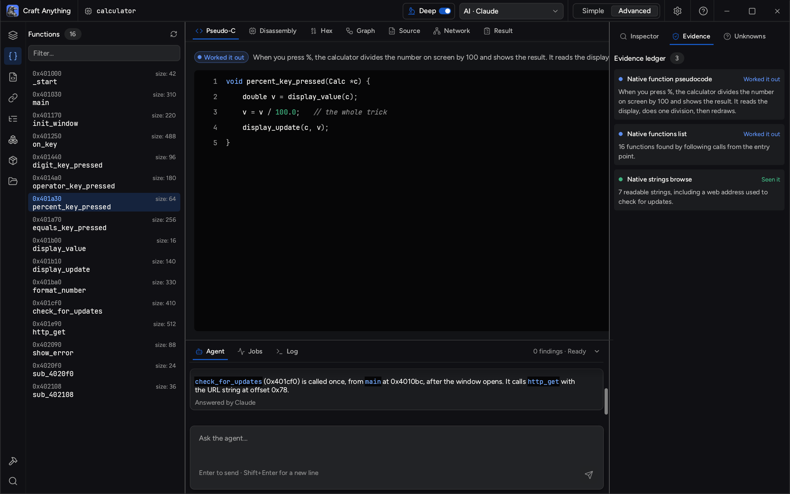

<p align="center">
  <a href="https://getartcraft.com/">
    <picture>
      <source media="(prefers-color-scheme: dark)" srcset="docs/brand/artcraft-logo-white.svg">
      
    </picture>
  </a>
</p>

<p align="center">
  
</p>

<h1 align="center">Craft Anything</h1>

<p align="center">
  <a href="README.md">English</a> · <a href="README.ja.md">日本語</a> · <a href="README.zh.md">简体中文</a> · <b>繁體中文</b> · <a href="README.ko.md">한국어</a> · <a href="README.es.md">Español</a> · <a href="README.fr.md">Français</a> · <a href="README.vi.md">Tiếng Việt</a> · <a href="README.pt.md">Português</a> · <a href="README.th.md">ไทย</a> · <a href="README.tr.md">Türkçe</a>
</p>

<p align="center">
  <b>看懂任何網站、應用程式或遊戲如何運作，再讓 AI 打造你自己的版本；一個以純 Rust 寫成的開源淨室引擎。</b><br>
  指定一個目標、說出你想要什麼，它就會用真正的檢查工具研究原作，<br>
  讓程式設計代理建立新專案，再拿成果和原作比對並加以改進。
</p>

<p align="center">
  
  
  
  
</p>

<p align="center">
  <a href="https://discord.gg/artcraft"></a>
</p>

<p align="center">
  <a href="#downloads"><b>下載 Craft Anything</b></a> ·
  <a href="https://getartcraft.com/">ArtCraft</a> ·
  <a href="https://getartcraft.com/apps">所有 Crafting Apps</a>
</p>

<br>

<p align="center">
  
  <br>
  <sub>網站專案：每次檢查都會說明成果有多相似，規則以外的動作都要經過你核准，計畫則顯示還剩下什麼。</sub>
</p>

> [!NOTE]
> **ArtCraft 是由各行各業的藝術創作者組成的社群。** 畫家、攝影師、
> 電影工作者、插畫家、設計師、動畫師、業餘愛好者，還有上週才剛拿起鉛筆的人。
> 只要你在創作，你就是我們的一員。**[來 Discord 打聲招呼吧](https://discord.gg/artcraft)。**

<p align="center">
  <a href="#how-it-works">運作方式</a> ·
  <a href="#two-ways-to-use-it">兩種用法</a> ·
  <a href="#ai">AI</a> ·
  <a href="#built-for-agents">代理</a> ·
  <a href="#under-the-hood">底層技術</a> ·
  <a href="#get-started">開始使用</a> ·
  <a href="#status">現況</a> ·
  <a href="#downloads">下載</a> ·
  <a href="https://discord.gg/artcraft">Discord</a>
</p>

<br>

<table>
  <tr>
    <td width="25%" valign="top">
      <h3>🔍 研究任何東西</h3>
      網站、桌面應用程式、手機應用程式、遊戲與檔案：用真正的檢查工具查出它們如何打造、做了什麼，每個答案都附上背後的證據。
    </td>
    <td width="25%" valign="top">
      <h3>🛠️ 打造你自己的版本</h3>
      說出你想要什麼（「重建這個網站」、「用 Rust 重建這款遊戲的玩法」），程式設計代理就會用你指定的技術堆疊建立新專案。
    </td>
    <td width="25%" valign="top">
      <h3>✅ 實際比對，不靠猜測</h3>
      每次建置都會和原作比對（三種螢幕寬度下的頁面、遊戲自己的自我測試、應用程式的實際執行），並持續改進到足夠接近為止。
    </td>
    <td width="25%" valign="top">
      <h3>🤖 為代理而生</h3>
      320 個工具，每一個既是 CLI 指令也是 MCP 工具，任何代理都能驅動與應用程式相同的引擎。檢查本身不需要 AI。
    </td>
  </tr>
</table>

<br>

## <a id="how-it-works"></a>運作方式

把 Craft Anything 指向一個目標、說出你想要什麼，然後按「開始」。它分成四個步驟進行，
遇到該由你決定的事，會用白話問你：

1. **研究：** 檢查原作：它在各種寬度下的頁面、程式碼、檔案，以及它如何執行。
2. **建置：** 程式設計代理會建立一個新專案，使用你的需求中指定的語言、框架或引擎（若沒指定則用合理的預設值）。
3. **檢查：** 拿建置成果和原作比對，列出還有哪些地方不一致。
4. **就緒：** 開啟、遊玩或預覽成果，也可以提出修改，讓它再加以改進。

<table>
  <tr>
    <td width="50%" valign="top">
      <br>
      <sub><b>製作：</b>選擇要重建什麼、說出你想要什麼，然後按「開始」。</sub>
    </td>
    <td width="50%" valign="top">
      <br>
      <sub><b>就緒：</b>開始玩遊戲，或在下方提出修改。</sub>
    </td>
  </tr>
</table>

## <a id="two-ways-to-use-it"></a>兩種用法

- **簡易**（預設）：「你想製作什麼？」選擇網站、應用程式或遊戲並加以描述，
  然後按「開始」。專案頁面會顯示四個步驟（研究 → 建置 → 檢查 → 就緒）、
  用白話說明代理正在做什麼、問題卡與核准卡、成果有多相似，
  以及開啟成果或其資料夾的按鈕。要修改時，在底部的輸入框中提出即可。
  「只檢視內部」會開啟一個目標供你提問，但不建置任何東西（在深度模式下）。
- **進階**：完整的工作臺：所有工具（Ctrl/Cmd+K）、函式、字串、C 偽程式碼、
  反組譯、十六進位、呼叫圖、證據、待確認事項、工作、記錄與代理主控台。

兩種模式驅動的是同一個引擎。

## <a id="clean-room-or-deep"></a>淨室或深度

- **淨室**（Clean room，預設）：完全不讀取原作的內部，不讀程式碼、檔案，也不讀網頁原始碼。
  Craft Anything 只根據你看得到的東西運作：你加入的圖片、訪客所看到的網站樣貌
  （螢幕截圖、可見文字、量測出的版面、顏色、字型與間距、展開後的選單），
  以及在你允許時，應用程式視窗的畫面。會查看內部的工具一律拒絕執行，
  並告訴你如何開啟深度模式。
- **深度**（Deep）：使用所有工具，僅供你私人使用。程式的程式碼與檔案由內建引擎讀取
  （已安裝 Ghidra 時也會用上），網站的 JavaScript 會被讀取、起始頁面會被監看，
  建置助手也可以使用以上全部。

淨室是一條規則，規範 Craft Anything 會提供什麼、拒絕什麼。它不是作業系統層級的沙盒：
它不會隔離你的電腦。你執行的程式設計代理仍然以你的身分行動，
它能讀取、寫入或執行什麼，取決於它自己的權限。Craft Anything 能拒絕代理自身的哪些工具，
因代理而異；關於 Claude Code 在聊天與提問中的工具，請參閱
[`docs/claude-code.md`](docs/claude-code.md)。

可在標題列或「設定」中切換，也可以用 `settings_set deep_mode true`，或只針對單次 CLI 執行加上
`--deep`（或 `--clean-room`）。

<p align="center">
  
  <br>
  <sub><b>進階：</b>函式、C 偽程式碼、代理，以及每個答案背後的證據。</sub>
</p>

## <a id="ai"></a>AI

建置需要你的電腦上有程式設計代理。目前優先支援 **Claude Code**：Craft Anything
執行的是你自己那份未經修改的 `claude` 程式，使用你自己的登入；Craft Anything
從不會看到或經手你的帳號。你的使用受你自己與 Anthropic 之間的協議規範。
原因與做法請見 [docs/claude-code.md](docs/claude-code.md)。
Codex 轉接器已經存在，但還沒在實際安裝上驗證過。**GitHub Copilot** 可以透過 ACP 使用你已安裝的
Copilot CLI：請另外用 `copilot login` 登入。其他支援 ACP 的代理（Gemini CLI、
Qwen Code、opencode、goose、Hermes、Maki）可以依後端各自切換過去；其中只有 Maki
實際執行過。Anthropic、OpenAI、OpenRouter 以及本機
OpenAI 相容伺服器可用於提問與分析（設定 → AI）。

## <a id="built-for-agents"></a>為代理打造

每個工具同時也是 CLI 子指令和 MCP 工具，所以代理不必開啟應用程式，
就能研究目標或執行完整的重建流程：

```sh
craft-anything-cli commands                                   # every tool, by toolset
craft-anything-cli mcp                                        # serve them to any MCP client
craft-anything-cli rebuild https://example.com "Recreate this website"
```

結果是附有信心度、涵蓋範圍與限制的證據紀錄；較大的結果會先回傳摘要，
再用 `core_evidence_browse` 分頁瀏覽。`craft-anything-cli setup`
會把 Craft Anything 連接到程式設計代理的應用程式。

## <a id="under-the-hood"></a>底層技術

一個純 Rust 的逆向工程引擎，有 320 個工具（引擎內有 300 個，其餘來自 AI 層與安裝設定層），
涵蓋原生程式、.NET、Java、Android、Apple、Electron/JavaScript、網站、
韌體、封包擷取檔、資料庫與遊戲檔案。
它自有的解碼器、反組譯器與反編譯器不需要任何外部程式就能運作；深度模式會用上全部，已安裝 Ghidra 時也會一併使用。
它驅動桌面應用程式（egui）、CLI 與 MCP 伺服器，其中部分功能也能以 WebAssembly
在瀏覽器中執行。完整清單請見 [docs/tools.md](docs/tools.md)。

## <a id="get-started"></a>開始使用

需要 Rust **1.97 或更新版本**（有個相依套件需要它；請執行 `rustup update`）。在 Debian 或 Ubuntu 上，
桌面應用程式還需要：

```sh
sudo apt-get install build-essential libxkbcommon-dev libxkbcommon-x11-0 libwayland-dev libx11-dev libxrandr-dev libxi-dev libgl1-mesa-dev libgtk-3-dev
```

接著：

```sh
git clone https://github.com/storytold/craft-anything && cd craft-anything
cargo run --release -p craft-anything                # the desktop app
cargo install --path apps/craft-anything-cli         # the CLI, as `craft-anything-cli`
craft-anything-cli doctor                            # checks the install, coding agents and engines
```

建置需要你的電腦上有已登入的程式設計代理（見 [AI](#ai)）；`doctor` 會告訴你還缺什麼。
從命令列重建的方式如下（問題會在終端機中詢問）：

```sh
craft-anything-cli rebuild https://example.com "Recreate this website"
craft-anything-cli rebuild - "A snake game in Rust" --rounds 1
craft-anything-cli rebuild https://example.com "Make the header blue" --continue-in "<project folder>"
craft-anything-cli rebuild - "Add a contact form" --project-folder "<your folder>" --existing edit
```

新專案會放在 `Documents/Craft Anything`（可在「設定 → 一般」中更改）。每個專案資料夾裡有
`craft.json`（需求、目標、狀態與歷史紀錄）、`capture/`（從目標記錄下來的內容）、
`app/`（產生的專案）、`checks/`（每一次與原作的比對）、
`investigation.cany/`（證據）與 `inbox/`（尚未回答的問題）。

專案也可以從你選的資料夾開始（「開始」下方的「選擇資料夾…」，或 `--project-folder`）。
如果資料夾裡已經有檔案，你要說明它們是什麼：是應用程式本身（建置助手會直接在原處編輯），
還是用來起頭的素材，此時應用程式會建在旁邊的 `app/` 中（「設定 → 一般」可以記住這個答案）。
「設定 → 一般」也會列出其他資料夾中的專案；移除其中一個只會把它從清單上拿掉。

## <a id="status"></a>現況

> [!IMPORTANT]
> **現況：** Craft Anything 正處於早期 alpha 階段。目前可用的、只完成一部分的，以及接下來要做的：
>
> - **目前可用：** 桌面應用程式（簡易與進階）、CLI 與 MCP 伺服器；以 Claude Code 為建置助手、
>   適用於網站、應用程式與遊戲的研究 → 建置 → 檢查 → 改進流程；在三種螢幕寬度下檢查網站；
>   以 Unity、Unreal 或 Godot 重建遊戲；搭配 Ghidra 的深度模式；
>   產生圖片與 3D 模型（需自行開啟，使用你自己的 fal.ai 金鑰）；外掛（MCP
>   伺服器，以及在啟用 `wasm-plugins` 選項的建置中使用 WASM 元件）。
> - **部分完成：** 使用 API 金鑰與其他程式設計代理進行建置（已實作，尚未實際執行過）、
>   應用程式與遊戲的行為檢查，以及少數只用替代品測試過的引擎工具。
> - **已發布：** 附有 Windows、macOS、Linux 與 FreeBSD 安裝程式的公開版本，
>   已發布在 [Releases 頁面](https://github.com/storytold/craft-anything/releases)；
>   這些版本仍屬 alpha。
> - **接下來：** 託管方案（managed tier）。
>
> [docs/STATUS.md](docs/STATUS.md) 有詳細說明以及每個部分的檢查方式，
> [docs/tool-status.md](docs/tool-status.md) 是逐一列出工具的檢查清單，
> [docs/ROADMAP.md](docs/ROADMAP.md) 則是逐項列出的計畫。歡迎提出 issue，
> 或到 [Discord](https://discord.gg/artcraft) 告訴我們哪裡壞了。

**負責任地使用。** 請只在你擁有或獲准檢查的軟體上使用 Craft Anything。它絕不會繞過 DRM、
登入機制或反作弊系統。重建是根據證據重現版面、風格與行為；
代理會被告知不要複製標誌、照片或文字，除非你確認自己擁有它們或已取得許可。

**安裝相依套件會執行程式碼。** 建置助手安裝專案的相依套件時，
那些指令會在你的電腦上執行，而套件在安裝期間也可能執行程式碼。
npm 預設會執行每個套件的安裝腳本，Rust 的建置腳本與 Python 原始碼套件也會執行它們自己的設定程式碼。
遇到這個專案中還沒出現過的指令類型（`npm`、`cargo`…），Craft Anything 會先詢問。
對 `npm` 選擇「一律允許」（always allow）後，之後每個 npm 指令都會直接執行、不再詢問，
所以只對你信任其相依套件的專案這麼做。若要安裝 npm 套件但不執行它們的安裝腳本，
請執行 `npm install --ignore-scripts`。

## <a id="downloads"></a>下載

在 GitHub 上，[最新版本](https://github.com/storytold/craft-anything/releases/latest)包含下列所有建置，[所有版本](https://github.com/storytold/craft-anything/releases)則有更早的版本與其版本說明。檔名中的 `<ver>` 是版本號，`SHA256SUMS.txt` 列出每個檔案的校驗碼。

### <a id="windows"></a>Windows

| 建置 | 安裝程式 | 免安裝版 |
|---|---|---|
| x64（64 位元 Intel/AMD） | `craft-anything-<ver>-windows-x64.msi` | `craft-anything-<ver>-windows-x64-portable.zip` |
| arm64（Snapdragon 與其他 ARM 電腦） | `craft-anything-<ver>-windows-arm64.msi` | `craft-anything-<ver>-windows-arm64-portable.zip` |
| x86（32 位元） | `craft-anything-<ver>-windows-x86.msi` | `craft-anything-<ver>-windows-x86-portable.zip` |

安裝程式與執行檔都有程式碼簽章。免安裝版 zip 會把設定存放在應用程式旁邊。

### <a id="macos"></a>macOS

| 建置 | 檔案 | 說明 |
|---|---|---|
| 應用程式，通用版（Apple 晶片 + Intel） | `craft-anything-<ver>-macos-universal.dmg` | 已簽章並經過公證 |
| 命令列工具，通用版 | `craft-anything-cli-<ver>-macos-universal.zip` | 已簽章並經過公證；若 macOS 擋下它，請見下方 |

0.2.0 之後的版本已在應用程式中附上命令列工具，所以這些版本不需要另外下載 zip。
只有在不透過應用程式、單獨使用命令列時才需要它。

用瀏覽器下載 zip 時，可能會被 macOS 擋下，顯示 Apple 無法驗證 craft-anything-cli 的訊息
（英文為 "Apple could not verify craft-anything-cli"；單一程式無法隨身攜帶公證資料，所以 macOS 必須上網查詢）。
從終端機下載不會經過這種檢查，所以請改用以下方式：

```sh
ver=0.2.0   # change this to the version you want
curl -fLO "https://github.com/storytold/craft-anything/releases/download/v$ver/craft-anything-cli-$ver-macos-universal.zip"
ditto -x -k "craft-anything-cli-$ver-macos-universal.zip" .
mkdir -p ~/.local/bin
mv "craft-anything-cli-$ver-macos-universal/craft-anything-cli" ~/.local/bin/
~/.local/bin/craft-anything-cli --version
```

若要直接以 `craft-anything-cli` 執行，請把 `~/.local/bin` 加進你的 `PATH`。

如果你已經有被擋下的那一份，請按「完成」（Done，不要按「丟到垃圾桶」Move to Bin），然後執行
`xattr -d com.apple.quarantine <path to craft-anything-cli>`，或到「系統設定 →
隱私權與安全性」按下「強制打開」（Open Anyway）允許它。

#### <a id="checking-that-a-mac-download-is-signed-and-notarized"></a>檢查 Mac 下載檔是否已簽章並經過公證

每個 Mac 版本都以 Developer ID 憑證簽章，並經過 Apple 公證。若要自行檢查下載的檔案，
請在「終端機」中執行以下指令（把 `<ver>` 換成版本號，路徑換成你自己的）：

```sh
# The disk image: "accepted" and "source=Notarized Developer ID" mean it passed
spctl --assess --type open --context context:primary-signature -v "craft-anything-<ver>-macos-universal.dmg"
# The notarization ticket is attached: prints "The validate action worked!"
xcrun stapler validate "craft-anything-<ver>-macos-universal.dmg"

# The app, after you open the disk image: the signature must verify
codesign --verify --deep --strict --verbose=2 "/Volumes/<disk image name>/Craft Anything.app"
spctl --assess --type execute --verbose "/Volumes/<disk image name>/Craft Anything.app"

# The command-line tool: a bare program can't carry a ticket, so macOS checks it online
codesign --verify --strict --verbose=2 ~/.local/bin/craft-anything-cli
codesign -dv --verbose=4 ~/.local/bin/craft-anything-cli 2>&1 | grep Authority
```

`Authority` 那幾行應該是「Developer ID Application」憑證。如果有任何一項檢查失敗，
請不要執行該檔案，並附上輸出內容與版本標籤回報。

### <a id="linux"></a>Linux

| 格式 | x86_64 | aarch64（ARM64） | 說明 |
|---|---|---|---|
| AppImage | `craft-anything-<ver>-linux-x86_64.AppImage` | `craft-anything-<ver>-linux-aarch64.AppImage` | 可在任何地方執行；可透過 [AppImageUpdate](https://github.com/AppImageCommunity/AppImageUpdate) 自行更新（`.zsync` 檔） |
| Flatpak | `craft-anything-<ver>-linux-x86_64.flatpak` | `craft-anything-<ver>-linux-aarch64.flatpak` | 在沙盒中執行； `flatpak install --user <file>` |
| Debian/Ubuntu | `craft-anything-<ver>-linux-x86_64.deb` | `craft-anything-<ver>-linux-aarch64.deb` | |
| Fedora/RHEL/openSUSE | `craft-anything-<ver>-linux-x86_64.rpm` | `craft-anything-<ver>-linux-aarch64.rpm` | |
| Tarball | `craft-anything-<ver>-linux-x86_64.tar.gz` | `craft-anything-<ver>-linux-aarch64.tar.gz` | 解壓縮到任何位置即可 |

RISC-V（riscv64）：`craft-anything-<ver>-linux-riscv64.tar.gz`，只提供 tarball。

AppImage 也內含 CLI：執行 `<AppImage> --cli <command>`（例如 MCP 用戶端可用
`<AppImage> --cli mcp`），或建立一個名為 `craft-anything-cli` 的連結指向 AppImage，
然後執行它。

### <a id="freebsd"></a>FreeBSD

| 建置 | 檔案 |
|---|---|
| x86_64 | `craft-anything-<ver>-freebsd-x86_64.tar.gz` |

### <a id="web-webassembly"></a>Web（WebAssembly）

| 建置 | 檔案 | 說明 |
|---|---|---|
| 瀏覽器檢視器 | `craft-anything-web-<ver>.zip` | 在瀏覽器裡告訴你一個檔案是什麼（檔案不會離開瀏覽器）；可把資料夾放到任何靜態網頁伺服器上（[packaging/web/README.md](packaging/web/README.md)） |

<br>

<p align="center">
  <a href="https://discord.gg/artcraft"></a>
</p>

<h3 align="center">一起來創作吧</h3>

<p align="center">
  我們的 Discord 是各種藝術創作者聚集的地方：畫畫的、拍照的、素描的、剪片的、
  做排版的，還有仍在摸索自己喜歡做什麼的人。分享你正在做的作品、
  尋求協助、告訴我們哪裡壞了，或告訴我們你希望這些工具能做到什麼。
  不論你用什麼媒材、創作了多久，這裡都歡迎你。
</p>

<p align="center">
  <a href="https://discord.gg/artcraft"><b>discord.gg/artcraft</b></a> ·
  <a href="https://getartcraft.com/">getartcraft.com</a> ·
  <a href="https://getartcraft.com/apps">Crafting Apps</a> ·
  <a href="https://github.com/storytold/craft-anything">Craft Anything</a>
</p>

---

## <a id="the-craft-app-suite"></a>The Craft App Suite

| | 應用程式 | 用途 | 原始碼 | 了解更多 |
|:-:|---|---|---|---|
|  | **PhotoCraft** | 影像編輯：圖層、遮色片、文字與真正的 PSD 檔案 | [GitHub](https://github.com/storytold/photocraft) | [網站](https://getartcraft.com/apps/photocraft) |
|  | **VectorCraft** | 向量插畫 | [GitHub](https://github.com/storytold/vectorcraft) | [網站](https://getartcraft.com/apps/vectorcraft) |
|  | **FilmCraft** | 影片剪輯、調色與音訊 | [GitHub](https://github.com/storytold/filmcraft) | [網站](https://getartcraft.com/apps/filmcraft) |
|  | **LightCraft** | 相片圖庫與 RAW 檔顯影 | [GitHub](https://github.com/storytold/lightcraft) | [網站](https://getartcraft.com/apps/lightcraft) |
|  | **PdfCraft** | 閱讀、整理與保護 PDF | [GitHub](https://github.com/storytold/pdfcraft) | [網站](https://getartcraft.com/apps/pdfcraft) |
|  | **EffectCraft** | 動態圖像與視覺特效 | [GitHub](https://github.com/storytold/effectcraft) | [網站](https://getartcraft.com/apps/effectcraft) |
|  | **DesignCraft** | 頁面排版與出版 | [GitHub](https://github.com/storytold/designcraft) | [網站](https://getartcraft.com/apps/designcraft) |
|  | **FigCraft** | 介面設計與原型製作 | [GitHub](https://github.com/storytold/figcraft) | [網站](https://getartcraft.com/apps/figcraft) |
|  | **WordCraft** | 文書處理與文件 | [GitHub](https://github.com/storytold/wordcraft) | [網站](https://getartcraft.com/apps/wordcraft) |
|  | **SoundCraft** | 音訊錄製與編輯 | [GitHub](https://github.com/storytold/soundcraft) | [網站](https://getartcraft.com/apps/soundcraft) |
|  | **DeckCraft** | 簡報與投影片 | [GitHub](https://github.com/storytold/deckcraft) | [網站](https://getartcraft.com/apps/deckcraft) |
|  | **CADCraft** | 電腦輔助設計 | [GitHub](https://github.com/storytold/cadcraft) | [網站](https://getartcraft.com/apps/cadcraft) |
|  | **GridCraft** | 試算表與資料 | [GitHub](https://github.com/storytold/gridcraft) | [網站](https://getartcraft.com/apps/gridcraft) |
|  | **TextureCraft** | 3D 材質繪製 | [GitHub](https://github.com/storytold/texturecraft) | [網站](https://getartcraft.com/apps/texturecraft) |
|  | **MaterialCraft** | 基於節點的程式化材質 | [GitHub](https://github.com/storytold/materialcraft) | [網站](https://getartcraft.com/apps/materialcraft) |
|  | **Craft Anything** | 看懂任何軟體如何運作，再打造你自己的版本 | [GitHub](https://github.com/storytold/craft-anything) | [網站](https://getartcraft.com/apps/craft-anything) |
|  | **SolidCraft** | Tangency Labs 出品的參數式 3D CAD（社群應用程式） | [GitHub](https://github.com/tangency-labs/solidcraft) | |


## <a id="license-and-credits"></a>授權與致謝

Craft Anything 採用 [MIT](LICENSE-MIT) 或 [Apache-2.0](LICENSE-APACHE) 雙重授權，由你擇一適用。
Copyright (c) 2026 ArtCraft Team and the Craft Anything contributors. 必要的聲明請見 [NOTICE](NOTICE)。

隨附的字型、圖示、圖片與其他素材各自保有其開放授權；每一項的作者、來源與授權都列在 [ATTRIBUTION.md](ATTRIBUTION.md) 中。

截圖中展示的是為截圖製作的範例專案：example.com、一個貪食蛇遊戲，以及一個小型計算機程式。

[`docs/brand/`](docs/brand/) 中的 ArtCraft 名稱、文字標誌與標誌圖案是 ArtCraft Team 的商標，
不在本授權範圍內。它們只能在未經修改的情況下，作為本儲存庫與 Craft Anything 的一部分使用，
並須遵守 [`docs/brand/LICENSE-brand.txt`](docs/brand/LICENSE-brand.txt)。
分支（fork）與修改版本必須移除它們。

<p align="center">
  <a href="https://getartcraft.com/"></a><br>
  <sub>由 <a href="https://getartcraft.com/">ArtCraft</a> 團隊與社群製作。</sub>
</p>

---

<sub>本頁是 [README.md](README.md) 的繁體中文翻譯；內容如有出入，以英文版為準。</sub>
